# Last Button

**Paste your website's address. Last Button finds every old PayPal button that may stop working after January 1, 2027, rebuilds each one as a PayPal Payment Link with the same product, options, postage and tax, and proves every new link takes a sandbox payment before you swap it in.**

Live demo: **https://last-button.onrender.com** (free Render instance: the first load can take about a minute to wake up)
Demo site to scan: https://last-button.onrender.com/demo-site/
Video: **https://youtu.be/23sDp25akxE** (2:55)

Built with **PayPal Payment Links and Buttons**, **PayPal Orders v2**, **PayPal webhooks**, **Gemini** (Google AI Studio), Playwright, AG Grid, Express/TypeScript and Render.

---

## The problem

PayPal is retiring Website Payments Standard (WPS), the copy-and-paste HTML **Buy Now** and **Add to Cart** buttons that millions of small sites have used since the 2000s:

> "PayPal may retire WPS anytime after January 1, 2027."
> [PayPal Developer: WPS deprecation](https://developer.paypal.com/limited-release/multiparty/wps-deprecation/)

- The same notice says only "critical security issues" are being fixed in the meantime, and that Donate and Subscribe buttons "will remain unaffected".
- PayPal's [Payments Standard docs](https://developer.paypal.com/api/nvp-soap/paypal-payments-standard/web/) say: "Use Payment Links and Buttons instead."

Vendors are warning their own users:
- [Gravity Forms](https://docs.gravityforms.com/paypal-payments-standard-add-on-end-of-life/) says payments through its PayPal Standard add-on will fail.
- [Timely](https://help.gettimely.com/hc/en-gb/articles/42941175737239-PayPal-integration-ending-in-Timely) says PayPal payments will stop processing from 1 January 2027.
- A [nopCommerce forum notice](https://www.nopcommerce.com/es/boards/topic/102732/sritical-paypal-changes) passes the change on to its users.
- The [Energise](https://www.energise.co.nz/blog/paypal-buttons-retirement-2027/) agency guide lists who is affected.

**The people with pasted buttons get no such warning.** Their sites are run by theatres, churches, clubs, craft sellers, old WordPress or static sites. The owners are not developers, and the button code lives in a CMS. Many buttons are *saved* (`hosted_button_id`) or *encrypted* (`cmd=_s-xclick`), so the product and price aren't even visible in the HTML. We don't know how many sites are affected and don't claim a number.

## What it does

1. **Find.**
   - Crawls the site: same origin, up to 30 pages, respects `robots.txt`, rate-limited.
   - Or takes pasted HTML.
   - Detects WPS forms and links (`cgi-bin/webscr`, sandbox too) and reads every field: `cmd`, `item_name`, `amount`, `currency_code`, `on0`/`os0`, `option_select*`/`option_amount*`, `shipping`/`shipping2`, `tax_rate`/`tax`, `quantity`/`undefined_quantity`, `hosted_button_id`, `encrypted`, `return`.
   - Pages whose scripts mention PayPal are rendered in Chromium, which catches buttons built by JavaScript.
   - Each button is classified as **may stop working** (Buy Now, Add to Cart, saved, encrypted) or **left alone** (Donate, Subscribe, including saved buttons showing a Donate image), with a plain-English reason.
2. **Rebuild.**
   - Readable fields are mapped deterministically to a Payment Links spec: name, price, currency, a priced option menu, flat postage with an extra-item amount, percentage tax, adjustable quantity and return URL.
   - **Gemini fills only the gaps**: saved and encrypted buttons, messy option menus, and currency ambiguity. It reads the text around the button (heading, paragraph, table row, image alt text).
   - Every value Gemini proposes must come with a **verbatim quote from the page**. A money value's quote must contain the number. Otherwise the value is thrown away.
   - Each field carries provenance (`html_field` / `page_context` + quote / `default` / `unknown`) and a confidence score.
   - Anything unknown or below 0.8 confidence goes to the owner. So does any price the AI read, by policy. Confirming is one click, or edit the values.
   - Each button gets plain-English change notes, e.g. "Payment Links sell one product per checkout, so buyers will pay for this item on its own rather than adding it to a basket."
3. **Migrate.**
   - One PayPal Payment Link per confirmed product (`POST /v1/checkout/payment-resources`).
   - Outputs:
     - a **patched HTML** download per page;
     - a **one-line `<script>`** that swaps the buttons at load time (works for JS-built buttons too);
     - **CSV/JSON** of every link;
     - schema.org **Product/Offer JSON-LD** so AI shopping agents can find a working checkout.
4. **Prove.**
   - A Playwright buyer bot pays through every new link with a PayPal sandbox buyer account. It picks the dearest option, so per-option pricing is really tested.
   - The order is then read back with **Orders v2** using our own app credentials. A row turns green only if all of these hold:
     - the order is `COMPLETED`;
     - the capture is `COMPLETED`;
     - the order's `item_id` is our link;
     - the option on the order is the one bought;
     - **paid = price + postage + tax** (tax on items only, as PayPal computes it).
   - A mismatch turns the row red with the reason.
   - The `CHECKOUT.PAYMENT-RESOURCE.PAYMENT-COMPLETED` webhook (signature verified with PayPal) adds a third tick when it lands, usually within a minute.

It is **not** a developer repo migrator, an agent-spending tool, or escrow.

## Architecture

```mermaid
flowchart LR
  U[Owner's browser] -->|URL or HTML| S[Express API on Render]
  S --> C[Crawler<br/>robots.txt, same-origin, 30 pages]
  C -->|scripts mention PayPal| PW1[Chromium render]
  C --> D[Detector + classifier]
  D --> M[Field mapper<br/>provenance per field]
  M -->|gaps only| G[Gemini<br/>structured JSON + schema check + 1 retry<br/>quote must be on the page]
  M --> O{Needs owner?}
  G --> O
  O -->|one click| L[PayPal Payment Links API<br/>POST /v1/checkout/payment-resources]
  L --> B[Playwright buyer bot<br/>sandbox buyer pays]
  B --> V[Orders v2 GET<br/>status, link id, option, amount]
  PP[PayPal webhooks<br/>PAYMENT-RESOURCE.PAYMENT-COMPLETED] --> S
  V --> T[AG Grid table: green only when the payment matches]
  T --> X[Patched HTML · swap script · CSV/JSON · JSON-LD]
```



Code map:

| Path | What it does |
|---|---|
| `src/scan/` | crawler, detector, Chromium rendering |
| `src/reconstruct/` | field mapper and AI gap-filler |
| `src/ai/` | provider interface and Gemini implementation |
| `src/migrate/` | Payment Links requests, workflow, outputs |
| `src/verify/` | buyer bot and webhooks |
| `public/` | the UI |
| `fixtures/` | demo site and eval sites with `truth.json` |
| `scripts/` | day-1 spikes and the eval |

Spike findings that shaped the design are in [`docs/SPIKES.md`](docs/SPIKES.md).

## Eval

`npm run eval` crawls four fixture sites with the real scanner and reconstructs with the real mapper and Gemini. It then scores everything against hand-written `truth.json` files. The sites:
- the Millbrook Players demo theatre;
- a WordPress-style craft shop;
- a church events table with saved buttons whose prices sit in neighbouring cells;
- a club page whose buttons are injected by JavaScript.

Latest run (`eval/results.json`, Gemini `gemini-3.5-flash` with `gemini-3.1-flash-lite` fallback):

| Measure | Result |
|---|---|
| Buttons in fixtures | 21 (17 affected, 4 Donate/Subscribe) |
| Detection precision / recall (affected) | **1.00 / 1.00** |
| Donate & Subscribe left alone | **4 / 4** |
| Field accuracy (7 fields × 17 buttons) | **119 / 119** |
| Hidden (saved/encrypted) prices recovered from page text | **6 / 6** |
| Buttons routed to the owner for a click | **7 / 17 (41%)**: every AI-read price, plus a flat tax and unknown postage |
| Wrong values that were *not* flagged for the owner | **0** |
| Verification on the live Render deployment (buyer bot + Orders v2 + webhook) | **7 / 7** demo links paid, amounts matched to the cent, 7/7 signed webhooks received |

**Read these numbers with care.**
- I wrote the fixtures myself, and there are only 21 buttons. Real sites will be messier, so treat this as a regression test, not a benchmark.
- Name matching is fuzzy: most expected words must be present, so "Millbrook Players gift voucher" counts for "Gift voucher".
- The 41% routed to a person is deliberate. We would rather ask than charge a price the AI guessed.
- The verified run is saved in [`fixtures/demo-run/`](fixtures/demo-run/) and shown at the live site's "Finished demo run" link. In an earlier local run, one of seven payments hit a transient PayPal sandbox error page; the bot now retries once, but only if no order was created yet.

## Run it yourself

Requirements: Node 20+, a PayPal developer account.

1. In the [PayPal developer dashboard](https://developer.paypal.com/dashboard/applications/sandbox), create a **sandbox REST app** on a **US business sandbox account** and enable **Payment Links & Buttons** under its features. An IN-region sandbox merchant declined some payments in our testing.
2. Note a **sandbox personal (buyer) account** login from *Testing Tools → Sandbox Accounts*.
3. Get a Gemini API key from [Google AI Studio](https://aistudio.google.com/).
4. Then:

```bash
git clone https://github.com/shivansh193/last-button && cd last-button
npm install
npx playwright install --only-shell chromium
cp .env.example .env   # fill in the values
npm run dev            # http://localhost:3000
```

For local scans of `http://localhost`, set `ALLOW_LOCAL_SCAN=1`. The public server refuses private addresses. Webhooks need a public https URL: register `https://<your-host>/api/paypal/webhook` with `npm run spike:webhook -- register <url>` and put its ID in `PAYPAL_WEBHOOK_ID`.

| Variable | What |
|---|---|
| `PAYPAL_CLIENT_ID`, `PAYPAL_CLIENT_SECRET` | sandbox app with Payment Links & Buttons |
| `SANDBOX_BUYER_EMAIL`, `SANDBOX_BUYER_PASSWORD` | sandbox personal account for the buyer bot |
| `GEMINI_API_KEY`, `GEMINI_MODEL`, `GEMINI_FALLBACK_MODELS` | AI gap-filling |
| `PAYPAL_WEBHOOK_ID` | to verify webhook signatures |
| `PUBLIC_BASE_URL` | public https address (return URLs, demo detection) |

Other commands:
- `npm run eval`: the eval above.
- `npm run spike:link` / `spike:pay` / `spike:webhook`: the day-1 spikes.

## Limitations

- **Sandbox only.** Links are created in the sandbox, and the buyer is a test account. Going live needs the owner's own PayPal app and keys.
- **One link sells one product.** Add to Cart becomes a single-item checkout, and the change notes say so.
- **One priced option menu.** A button with two option menus (`on1`) goes to the owner.
- **No fixed quantity above 1.** A flat `tax` amount is converted to a percentage, and the owner confirms it.
- **Saved buttons hide their settings.** The settings of saved (`hosted_button_id`) buttons live inside the merchant's PayPal account, so we can only read what the page says. Postage or tax configured in the PayPal profile is invisible to us, and the owner is asked.
- **Verification is slow on purpose.** It takes about 25–40 s per link, runs one at a time, and covers one purchase per link. It tests the dearest option, not every option.
- **Patched HTML** can only replace buttons that exist in the page source. JS-built buttons need the swap script.
- **The free Render instance** sleeps when idle and has an ephemeral disk. A verified demo run ships in `fixtures/demo-run/` so the result is visible after a restart.
- **Only USD and GBP fixtures are tested.** Only USD has been paid end to end.

## License

MIT, see [LICENSE](LICENSE).
